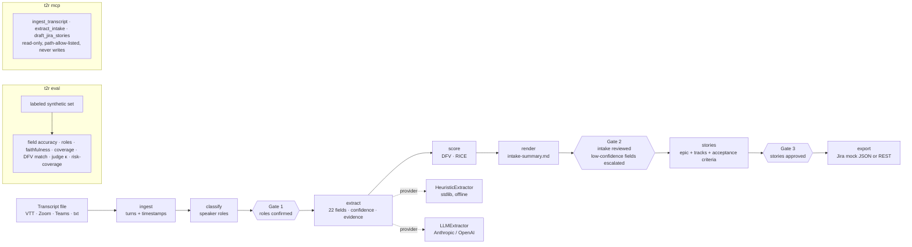

# Architecture

## Modules
| Module | Responsibility |
|---|---|
| `ingest.py` | Detect format; parse cues into speaker turns with normalized timestamps; merge consecutive same-speaker cues. |
| `classify.py` | Heuristic speaker roles (facilitator, requester, sponsor, user, engineer); exactly one facilitator; per-speaker confidence. |
| `extract.py` | Two providers behind one contract. Heuristic: sentence cues → field value, evidence, basis, confidence. LLM: JSON schema prompt; quotes re-attached to turns; untraceable quotes cap confidence at 0.4. Latent-need rules. |
| `score.py` | DFV 1–5 per component with a one-line rationale and an explicit label rule; RICE with reach/impact/confidence/effort. |
| `gates.py` | Three human gates; `ReviewerBudget(threshold, max_items)` decides which fields are escalated at Gate 2; `--approve-all` for CI. |
| `stories.py` | Epic + one story per evidenced track (discovery, data, model, integration, governance, enablement) with acceptance criteria and evidence. |
| `export.py` | Jira payloads; mock adapter (JSON files) by default; REST adapter only when `T2R_JIRA_URL` is set. |
| `pipeline.py` / `cli.py` | Orchestration and CLI. |
| `mcp_server.py` | FastMCP tools for agents; read-only by design. |
| `eval/harness.py` | Metrics, risk–coverage sweep, rubric judge and κ against human rulings, RESULTS.md. |

## Design choices
- **Evidence on every field.** A field without a timestamped quote is a guess; the renderer shows the quote next to the value so Gate 2 is a review, not a re-read.
- **Confidence is a routing signal, not a grade.** The reviewer budget spends human attention on the fields below the threshold; the eval publishes the risk–coverage curve so the threshold is chosen on data.
- **Two providers, one contract.** The heuristic baseline keeps the whole system runnable and testable offline; the LLM provider is where accuracy comes from. The eval reports both so the delta is visible.
- **Nothing writes before Gate 3.** The MCP tools cannot write at all; export is a CLI step after a person approves.
